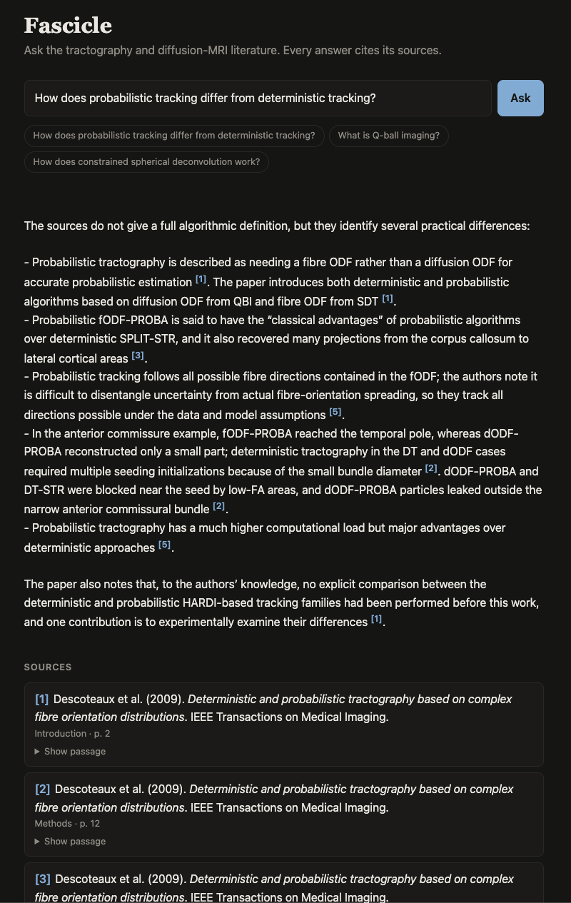

# Fascicle

[](https://github.com/deka27/fascicle/actions/workflows/ci.yml)

**Retrieval-augmented question answering over the tractography and diffusion-MRI literature.**

Ask a question about diffusion MRI, fiber tracking, bundle segmentation, or microstructure modeling. Fascicle retrieves the relevant passages from a curated corpus of research papers and answers **with citations back to the source paper and section**.

<p align="center"></p>

---

## Motivation

General-purpose "chat with your PDFs" tools handle scientific literature poorly: multi-column layouts, equations, and figure captions break extraction, and answers rarely say where a claim came from. Fascicle targets one field and is built around three ideas:

- **Domain-aware ingestion.** Chunks follow paper structure (Abstract / Methods / Results) so retrieval and citations can point at a specific section.
- **Grounded answers.** The model answers only from retrieved context, and every answer carries citations.
- **Measured quality.** A hand-written evaluation set with known correct answers tracks retrieval precision and faithfulness across changes.

---

## Features

- Ingests dMRI / tractography papers (PDF + text).
- Chunks and embeds them into a local vector store.
- Answers natural-language questions from retrieved context, with inline citations.
- Streams responses through a REST API.
- Evaluates retrieval and answer quality against a labelled question set, tracked in MLflow.
- Ships as a Docker image; every merge to `main` is tested and deployed to AWS ECS Fargate.

---

## Architecture

```
                 ┌─────────────────────────────────────────────┐
                 │                INGESTION                      │
   papers/ ─────▶│  parse PDFs → section-aware chunk → embed     │
   (PDF, txt)    │             → store in vector DB              │
                 └───────────────────────┬─────────────────────┘
                                         │
                                         ▼
                              ┌────────────────────┐
                              │   Vector store      │
                              │   (Chroma, local)   │
                              └─────────┬──────────┘
                                         │ retrieve top-k
                                         ▼
   user query ──▶ FastAPI /query, /stream ──▶ Retriever ──▶ LLM (+ context) ──▶ answer + citations
                       │
                  web UI (/), /health

   eval/questions.jsonl ──▶ eval harness (retrieval metrics + LLM judge) ──▶ MLflow
```

Ingestion, embedding, and retrieval run locally. Only the LLM call and the deployed service use external resources.

---

## Tech stack

| Layer | Choice |
|---|---|
| Language | Python 3.12 |
| PDF parsing | `pypdf` |
| Embeddings | `sentence-transformers` (local) |
| Vector store | Chroma |
| LLM | DeepSeek API (OpenAI-compatible) |
| Serving | FastAPI |
| Frontend | Single HTML page (vanilla JS), served by FastAPI |
| Experiment tracking | MLflow |
| Evaluation | Ragas (faithfulness) + labelled retrieval metrics |
| Containerization | Docker |
| CI/CD | GitHub Actions |
| Deployment | AWS ECS Fargate (ARM64) + ECR |

---

## Corpus

The seed corpus covers:

- Diffusion tensor imaging and its foundations (Basser et al.)
- Deterministic and probabilistic fiber tracking (Mori, Conturo, Jones, …)
- High angular resolution methods: Q-ball, CSD / FOD-based tracking (Tuch, Tournier, Descoteaux, Jeurissen, …)
- Diffusion spectrum imaging and fiber architecture (Wedeen et al.)
- Tract anatomy and dissection (Catani et al.)

Planned additions: probabilistic tracking (Behrens), anatomically-constrained tractography and SIFT, bundle segmentation (RecoBundles, TractSeg), microstructure models (NODDI, DKI), known limitations of tractography, and review papers.

Layout:
```
papers/
  raw/            # original PDFs (gitignored)
  processed/      # extracted text + metadata (title, authors, year, section)
  manifest.json   # document ids, used for citation lookup
```

PDFs are not redistributed in this repository. `papers/raw/` is gitignored; supply your own copies.

---

## Repository structure

```
fascicle/
├── README.md
├── requirements.txt            # runtime (what the container installs)
├── requirements-dev.txt        # + tests, lint, evaluation
├── .env.example                # environment variables (API keys)
├── papers/                     # corpus (see above)
├── src/
│   ├── ingest/                 # parse, chunk, embed, load to vector store
│   ├── rag/                    # retrieval, generation, citation assembly
│   ├── api/                    # FastAPI app (query, stream, health)
│   └── eval/                   # evaluation harness
├── frontend/index.html         # web UI, served at /
├── eval/
│   └── questions.jsonl         # question → reference answer pairs
├── tests/
├── Dockerfile
├── .github/workflows/ci.yml
└── notebooks/                  # experiments (excluded from the image)
```

---

## Roadmap

### Phase 0 — Project setup
- [x] Repository, virtualenv, `requirements.txt`, `.env.example`
- [x] Corpus collected in `papers/raw/`

### Phase 1 — Baseline RAG
- [x] Extract text → fixed-size chunks → embed → load into Chroma
- [x] Retrieve top-k chunks and answer with one LLM call
- [x] `POST /query` endpoint

### Phase 2 — Retrieval quality
- [x] Section-aware chunking with metadata (title, year, section)
- [x] Citations in responses (paper + section per claim)
- [x] Streaming responses (SSE) and `/health`
- [ ] Metadata filters (year, author)

### Phase 3 — Web UI
- [x] Question box with streamed answer and visible citations
- [x] Source panel showing the papers and sections each answer drew from

### Phase 4 — Evaluation
- [x] 24 question → reference answer pairs in `eval/questions.jsonl`, each labelled with its source paper(s)
- [x] Metrics: retrieval hit rate / precision / MRR, answer faithfulness (Ragas), answer correctness
- [x] Baseline results recorded in MLflow, with chunk size, top-k, and prompt variants as params
- [ ] Improve retrieval against the baseline

### Phase 5 — Containerization and CI
- [x] Multi-stage `Dockerfile` (CPU-only torch, embedding model baked in, index mounted at run time)
- [x] `pytest` coverage for chunking, section detection, retrieval, API, and eval metrics
- [x] GitHub Actions: lint → test → build

### Phase 6 — Deployment
- [x] Private ECR registry + ECS Fargate deployment (ARM64, us-east-2), verified live, then scaled to zero
- [x] Deploy on merge to `main` from GitHub Actions

---

## Getting started

```bash
git clone https://github.com/deka27/fascicle.git
cd fascicle
python3.12 -m venv .venv && source .venv/bin/activate
pip install -r requirements-dev.txt
cp .env.example .env          # add your API key

# ingest the corpus
python -m src.ingest.run --papers papers/raw

# run the API + web UI, then open http://localhost:8000
uvicorn src.api.main:app --reload

# tests and lint
python -m pytest -q && ruff check .
```

### Docker

The image contains the app and the embedding model but not the index, which holds text from copyrighted papers. Build the index locally (above), then mount it:

```bash
docker build -t fascicle .
docker run -p 8000:8000 --env-file .env -v "$PWD/chroma:/app/chroma" fascicle
```

`/health` reports the number of indexed chunks, so `"chunks": 0` means the index wasn't mounted.

## Deployment (AWS ECS Fargate)

The app runs as one Fargate task (ARM64, 0.5 vCPU / 2 GB) in `us-east-2`, pulled from a private ECR repository. The deploy image is the app image plus the index, so it stays in the private registry; the DeepSeek key is read from SSM Parameter Store (`/fascicle/deepseek-api-key`) at start-up. The task definition is in [`.aws/task-definition.json`](.aws/task-definition.json).

**Continuous deployment.** On every push to `main`, after lint and tests pass, GitHub Actions builds the image on an ARM runner, adds the index from a private S3 bucket (`s3://fascicle-index-008402585108/index.tar.gz`), pushes it to ECR tagged with the commit SHA, and updates the ECS service. AWS access uses a least-privilege deploy user (push to this repository, read the index object, update this one service) whose keys are GitHub secrets. A deploy keeps the service's desired count, so a scaled-to-zero service stays off and starts on the latest version. ECR keeps the 5 newest images.

After re-ingesting the corpus, upload the new index so the next deploy picks it up:

```bash
tar czf - -C chroma . | aws s3 cp - s3://fascicle-index-008402585108/index.tar.gz
```

The service is scaled to zero when not in use. To run it (~$0.70/day while up):

```bash
aws ecs update-service --cluster fascicle --service fascicle --desired-count 1
aws ecs wait services-stable --cluster fascicle --services fascicle
# public IP of the running task (changes on every start); the app is on port 8000
TASK=$(aws ecs list-tasks --cluster fascicle --service-name fascicle --query 'taskArns[0]' --output text)
ENI=$(aws ecs describe-tasks --cluster fascicle --tasks "$TASK" --query "tasks[0].attachments[0].details[?name=='networkInterfaceId'].value" --output text)
aws ec2 describe-network-interfaces --network-interface-ids "$ENI" --query 'NetworkInterfaces[0].Association.PublicIp' --output text

# stop it
aws ecs update-service --cluster fascicle --service fascicle --desired-count 0
```

## Usage

```bash
curl -X POST localhost:8000/query \
  -H "Content-Type: application/json" \
  -d '{"question": "How does probabilistic tracking differ from deterministic tracking?"}'
```

Returns an answer with the source passages and papers it was drawn from.

```bash
# stream the answer as server-sent events: one sources event, then tokens
curl -N -X POST localhost:8000/stream \
  -H "Content-Type: application/json" \
  -d '{"question": "What is Q-ball imaging?"}'

# liveness + number of indexed chunks
curl localhost:8000/health
```

Adding a paper: put the PDF in `papers/raw/`, add its entry to `papers/manifest.json`, and re-run ingestion (it rebuilds the index).

## Evaluation

```bash
python -m src.eval.run              # full run: retrieval + answers judged by DeepSeek (~5 min)
python -m src.eval.run --no-judge   # retrieval metrics only, no LLM calls (seconds)
mlflow ui --backend-store-uri sqlite:///mlflow.db   # browse and compare runs
```

Each question in `eval/questions.jsonl` has a reference answer and the paper(s) that contain it.

| Metric | What it measures | Baseline |
|---|---|---|
| Hit rate | Questions with at least one retrieved chunk from a relevant paper | 1.000 |
| Precision | Retrieved chunks that come from a relevant paper | 0.675 |
| MRR | 1 / rank of the first relevant chunk | 0.833 |
| Faithfulness | Answer claims supported by the retrieved passages (Ragas, DeepSeek judge) | 0.972 |
| Correctness | Reference-answer claims covered by the answer (DeepSeek judge) | 0.688 |

Baseline: `all-MiniLM-L6-v2` embeddings, 1000-char sentence chunks, k = 5, `deepseek-reasoner`. Answers rarely invent claims; most lost correctness comes from questions where retrieval misses the key passage and the model correctly says the sources don't cover it. LLM answers and judging vary between runs by a few points, so treat differences under ~0.05 as noise.

### Experiments

| Change | Hit rate | Precision | MRR | Outcome |
|---|---|---|---|---|
| Baseline: `all-MiniLM-L6-v2` | 1.000 | 0.675 | 0.833 | kept |
| `BAAI/bge-base-en-v1.5` | 0.875 | 0.667 | 0.800 | reverted |
| `BAAI/bge-base-en-v1.5` + BGE query instruction | 0.875 | 0.692 | 0.812 | reverted |

bge-base retrieved better for conceptual questions (DSI, brainstem segmentation, the reeler mouse study) but lost questions keyed on acronyms and author names (FACT, CSA, "Tuch et al."), returning generic tracking passages instead. Exact-term matching is a dense-embedding weakness, which points to hybrid retrieval (BM25 + dense) as the next experiment.

---

## Future work

- Hybrid retrieval (BM25 + dense) with a reranker
- Keyless CI deploys via GitHub OIDC instead of a deploy user's access keys (OIDC providers are blocked in the current AWS account)
- Monitoring with Evidently: log production queries, then track drift of query embeddings away from the corpus and answer-quality regressions
- Multi-turn conversation
- Figure and table extraction

## License and data

Code is provided for research and educational use. Papers in the corpus remain under their publishers' licenses and are not included in this repository.
